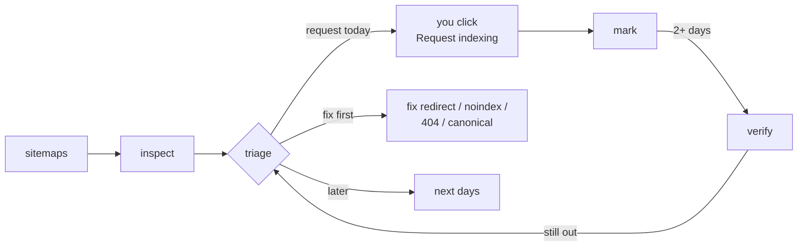
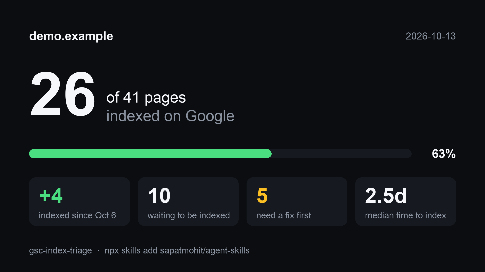

<div align="center">

# agent-skills

**Skills for coding agents that do real work, not just talk about it.**

Works with Claude Code, Codex, Cursor, Gemini CLI, GitHub Copilot and [40+ other agents](https://github.com/vercel-labs/skills#supported-agents) that read `SKILL.md`.

[](LICENSE)
[](https://skills.sh/sapatmohit/agent-skills)


```bash
npx skills add sapatmohit/agent-skills
```

or, in Claude Code: `/plugin marketplace add sapatmohit/agent-skills` then `/plugin install agent-skills@sapatmohit`

</div>

---

## Skills

| Skill | What it does |
|---|---|
| [**gsc-index-triage**](#gsc-index-triage) | Finds pages Google hasn't indexed and tells you which ones deserve today's few "Request indexing" clicks, which ones need a fix instead, and whether the requests worked. Tracks the rolling 24h quota, flags orphan pages, submits to Bing via IndexNow, and makes a shareable coverage card. |

---

## gsc-index-triage

> Search Console lets you click **Request indexing** only about 10 times a day per property, and the API can't do it at all. This skill makes those clicks count.

Ask your agent *"why aren't my new pages on Google?"* or *"what should I request indexing for today?"* and it will:

1. **Inspect every URL in your sitemaps** with the URL Inspection API. It saves dated snapshots, so it can tell you what got indexed and what dropped out since last time.
2. **Separate "request" from "fix first."** Redirects, `noindex`, 404s, robots blocks and canonical mismatches won't be fixed by a request. Each gets a one-line fix.
3. **Rank the rest.** Pages Google has never seen, pages with past impressions, and pages updated since their last crawl go first. Legal, author, tag and pagination pages go last.
4. **Hand you a list sized to what's left of your quota.** The quota resets on a rolling 24 hours, not at midnight, so it tracks when you clicked and tells you when the next slot opens.
5. **Flag orphans.** A new page nothing links to tends to stay "Discovered" or fall back out after a request. `links` finds them.
6. **Check whether the requests landed** and measure it: median time to index, requests stuck after 14 days, and the traffic those pages earned since.
7. **Turn "fix first" into sitemap edits,** and submit everything to Bing, Yandex & co. via **IndexNow**, which (unlike Google) accepts automated submissions.
8. **Report what matters:** clicks, impressions, CTR and position against the previous period, plus *striking-distance* queries (position 4–20) and page-1 queries with zero clicks.



### Try it in 30 seconds, no setup

`--demo` runs every command on a made-up site with a week of history. No key, nothing sent anywhere:

```bash
git clone https://github.com/sapatmohit/agent-skills && cd agent-skills/skills/gsc-index-triage
uv run scripts/gsc_triage.py --demo inspect
uv run scripts/gsc_triage.py --demo triage
uv run scripts/gsc_triage.py --demo card
```

`card` makes this, ready to post:



### What it looks like


```text
$ gsc_triage.py inspect
sc-domain:example.com: 107 URLs from 3 sitemap(s); inspecting 107
107 URLs: 84 indexed, 21 request, 2 fix, 0 error
newly indexed since 2026-10-05: 4
  + https://example.com/blog/next-intl-vs-react-i18next/
  + https://docs.example.com/integrations/django

$ gsc_triage.py triage --quota 5
Request indexing for these today (Search Console > URL inspection > Request indexing):

 1. https://docs.example.com/cli/check
      score 42.0: Google has never seen it
 2. https://example.com/blog/icu-plurals/
      score 57.0: crawled but not indexed (quality call); updated 2026-10-09 after last crawl 2026-09-02; fresh (lastmod 2026-10-09)
 ...

Fix, don't request (2): requesting won't help until these are fixed
  - https://example.com/old-pricing
      Page with redirect: sitemap lists a redirecting URL; list the final URL instead
  - https://example.com/drafts/launch
      Excluded by 'noindex' tag: page has noindex; remove it from the sitemap, or drop the noindex if it should rank

$ gsc_triage.py verify
  indexed    3d  https://docs.example.com/cli/check
  not yet    3d  https://example.com/blog/icu-plurals/  (Crawled - currently not indexed)
1/2 requested URLs indexed

$ gsc_triage.py report --exclude-query 'yourbrand'
sc-domain:example.com  2026-09-12 .. 2026-10-09  vs  2026-08-15 .. 2026-09-11
  clicks       39 (prev 31)
  impressions  1033 (prev 595)
  CTR          3.78% (prev 5.21%)
  avg position 9.2 (prev 16.9)  (lower is better)

Striking distance (position 4-20, >= 10 impressions): improve these pages first
    8.6      15 imp     0 clk  icu messageformat  ->  https://example.com/blog/icu-plurals/
```

### Commands

| Command | Purpose |
|---|---|
| `doctor` | Check the setup and print the exact fix for whatever fails |
| `sites` | List the properties your credential can see |
| `inspect` | Inspect every sitemap URL and save a snapshot (`--skip-indexed`, `--max N`, `--sitemap URL`, `--urls-file`) |
| `triage` | Rank unindexed URLs (`--quota N`, `--cooldown DAYS`, `--low-value REGEX`, `--json`) |
| `mark URL...` | Record the URLs you requested in the Search Console UI (`--at HH:MM`) |
| `quota` | Requests used in the rolling 24h window and when the next one frees up |
| `verify` | Re-inspect requested URLs and report which got indexed |
| `stats` | Median time to index, requests stuck after 14 days, traffic earned since indexing |
| `daily` | `inspect --skip-indexed` + `verify` + `triage`, for a morning cron job |
| `links` | Find sitemap pages that no other page links to (orphans) |
| `fixes` | Turn "fix, don't request" URLs into sitemap edits (`--write sitemap.xml`, `--json`) |
| `indexnow` | Submit URLs to Bing, Yandex, Seznam, Naver and Yep (`--setup`, `--changed`, `--dry-run`) |
| `card` | Shareable 16:9 PNG of your index coverage (`--out`) |
| `report` | Compare performance with the previous period, plus striking-distance and zero-click queries (`--days`, `--exclude-query`) |
| `sitemaps` | List sitemaps with last-download date, or resubmit them (`--submit URL`) |

Global flags: `--demo`, `--site`, `--key`, `--daily-limit N` (default 10, or `GSC_DAILY_LIMIT`).

### Setup (about 5 minutes, free)

1. In the [Google Cloud console](https://console.cloud.google.com/apis/library/searchconsole.googleapis.com), enable the **Google Search Console API** (no billing needed).
2. Go to **IAM & Admin → Service accounts → Create**, then **Keys → Add key → JSON**.
3. Save the key and lock it down:
   ```bash
   mkdir -p ~/.config/gsc && mv ~/Downloads/<key>.json ~/.config/gsc/key.json && chmod 600 ~/.config/gsc/key.json
   export GSC_KEY=~/.config/gsc/key.json
   ```
4. In Search Console, go to **Settings → Users and permissions → Add user**, paste the service account email, and choose **Restricted** (read-only).

Or skip the key file and use `gcloud auth application-default login --scopes=https://www.googleapis.com/auth/webmasters.readonly,https://www.googleapis.com/auth/cloud-platform`.

Then run `doctor`. It checks each step and tells you exactly what to fix:

```text
$ gsc_triage.py doctor
  ok    key ~/.config/gsc/key.json for gsc-reader@my-project.iam.gserviceaccount.com
  ok    got an access token
  ok    sees 1 property: sc-domain:example.com
  ok    sc-domain:example.com: 3 sitemap(s) submitted

all set. next: `inspect`
```

### Run it every morning

```bash
# crontab -e
0 8 * * * GSC_KEY=~/.config/gsc/key.json uv run ~/agent-skills/skills/gsc-index-triage/scripts/gsc_triage.py daily > ~/gsc-today.txt
```

### Use it without an agent

It's a single Python file with three dependencies, declared inline so that [`uv`](https://docs.astral.sh/uv/) installs them on the fly:

```bash
uv run skills/gsc-index-triage/scripts/gsc_triage.py inspect
# or: pip install google-auth requests pillow && python3 skills/gsc-index-triage/scripts/gsc_triage.py inspect
```

State (snapshots, the request log, link counts and the IndexNow key) lives in `~/.local/state/gsc-triage/<property>/`.

### Good to know

- **The API can't request indexing.** Only the Search Console UI can. Google's *Indexing API* is restricted to job-posting and livestream pages, so this skill won't pretend otherwise.
- **"Crawled – currently not indexed"** means Google saw the page and passed. A request alone rarely changes that: improve the page and its internal links first. Triage boosts these only when the page changed after its last crawl.
- **Quotas:** about 10 manual requests per property per rolling 24 hours (sometimes fewer; it doesn't reset at midnight), and 2,000 API inspections per day per property. On big sites use `inspect --skip-indexed`.
- **IndexNow doesn't reach Google.** It covers Bing (and the AI assistants that search through it), Yandex, Seznam, Naver and Yep.
- New pages enter the rankings low, so the average position can dip right after you publish. Judge trends over 4–8 weeks.

---

## Development

```bash
python3 -m unittest discover skills/gsc-index-triage/tests
```

Issues and PRs welcome.

## License

[MIT](LICENSE) © Mohit Sapat

---

<div align="center">

Made by **Mohit Sapat**

[](https://mohitsapat.me)
[](https://x.com/mohitsapat18)
[](https://www.linkedin.com/in/mohitsapat18/)
[](https://github.com/sapatmohit)

</div>
